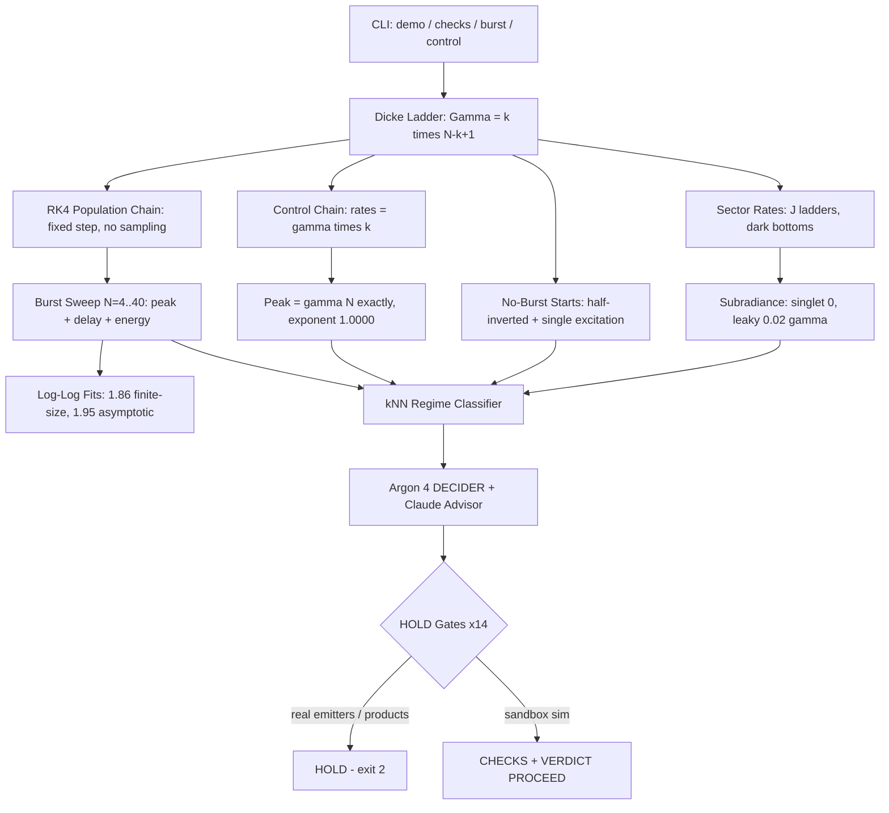
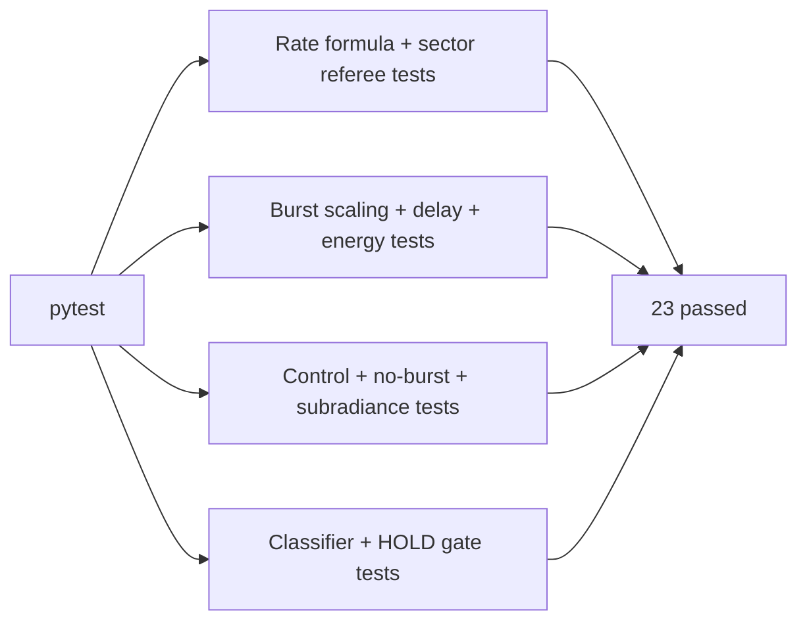
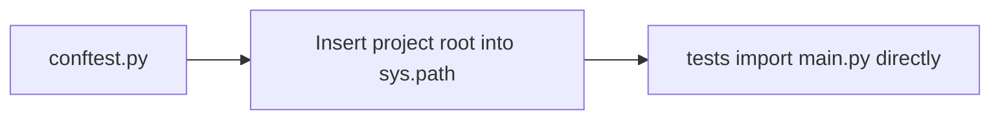
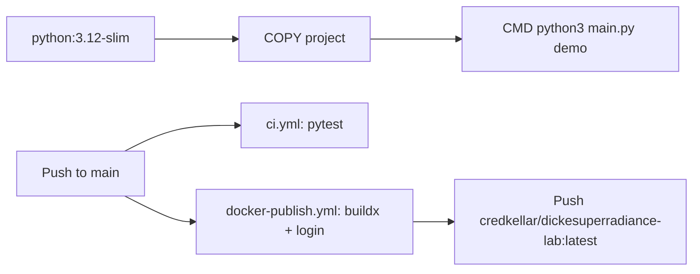

# DickeSuperradiance-Lab 💥⚛️

**Collective Emission Lab — the Dicke Ladder, the Superradiant Burst & the Dark Sectors** — by Darion Kellar

DickeSuperradiance-Lab is an **educational collective-emission lab** in ONE pure-Python file. It builds the textbook Dicke model from its one honest ingredient — the transition-rate formula — and then makes the model prove its own headlines:

- **The symmetric ladder**: N identical two-level emitters sharing ONE radiation mode live on a ladder of N+1 states |J, m⟩ with J = N/2, and the rate down each rung is **Γ = γ · k · (N − k + 1)** — slow at the ends (γN), fast mid-ladder (up to γ·⌊(N+1)²/4⌋ = 420γ at N = 40).
- **The burst**: start fully inverted and the population climbs toward the fast rungs, so the emitted intensity rises into a delayed pulse. Peak intensity fits **N^1.86** over N = 4..40 and **N^1.95** over N = 20..40 — approaching the famous N² law, with the finite-size exponent printed honestly instead of rounded up to 2.
- **The receipts**: the integrated intensity must total exactly **N photons** (worst error 1.85e-04 over the whole sweep), the delay follows **(ln N)/(Nγ)**, and an independent-emitter control — same machinery, collective factor removed — peaks at exactly γN with fit exponent **1.0000**.

Honest scope, stated up front: this is the **ideal Dicke model** — identical emitters, identical coupling, a sample small against the wavelength, no dephasing, no inhomogeneous broadening. Those idealisations are why the subradiant states here are *exactly* dark, and the lab says so every time it shows one. No emitter, laser, or cavity exists here; every hardware / product claim sits behind a permanent HOLD gate (14 total). 🔒

[](https://github.com/kimanicollier44-cmyk/DickeSuperradiance-Lab/actions/workflows/ci.yml)
[](https://github.com/kimanicollier44-cmyk/DickeSuperradiance-Lab/actions/workflows/docker-publish.yml)

> ℹ️ These are the **live** workflow badges for this repo. They activate as soon as the `ci.yml` and `docker-publish.yml` files from the paste pack are pasted into `.github/workflows/` — until then they have nothing to report yet.

## 🧰 Tech Stack Badges & Full Architecture Tech Stack

### 💻 Core Programming Languages & Core Systems


- 🐍 Python 3.12, pure standard library (`math`, `hashlib`, `json`, `sys`) — zero dependencies, zero network, deterministic (double-run byte-identical)
- 🪜 Dicke ladder core from scratch: the rate table Γ_k = γ·k·(N − k + 1) for the symmetric sector and the general sector rate Γ(J, m) = γ(J+m)(J−m+1), with the two refereed against each other on every rung in CHECKS
- 🔢 Deterministic integrator: fixed-step RK4 on the population death chain, dt = 0.1 / (largest rate), run until the mean excitation falls below 1e-11 — no sampling, no random numbers, so the energy bookkeeping (trapezoid integral of the same series) can be graded against the exact total N
- 📈 Scaling fits from scratch: least-squares on log–log axes for the burst peak (N = 4..40 and the N ≥ 20 asymptotic window) and for the independent-emitter control
- 🧠 TinyML kNN regime classifier (from scratch, stdlib, distance-weighted): superradiant-burst / collective-monotone / independent-like / subradiant-dark from (collectivity R, contrast C, initial rate per excitation r0), labels from the lab's own policy
- 🪑 Council seats: Gemini Argon 4 DECIDER (names-only, tighten-only) + Muse advisor (never overrides HOLD) + Google Flow plan-only (rendered = False, live = 0)

### ⛓️ Web3 & Infrastructure

- 🚫 **Not applicable — honestly.** No blockchain, no Web3, no tokens: the "infrastructure" in this lab is one offline file holding a rate table and a population chain. Real emitter arrays and laser systems are permanent HOLD gates, not features. No fake badges here.

### ⚙️ Platform Support & Hardware Architecture


- 🖥️ Pure Python — runs anywhere Python 3.12+ runs (Linux, macOS, Windows), plus the `python:3.12-slim` Docker image
- 🔒 No hardware is controlled, ever: real emitters, pumps, cavities, and readout chains are permanent HOLD gates (see the gate table below)

### ⚡ Low-Level Infrastructure & Performance

- 🚫 **No low-level code — honestly.** No C, no C++, no GPU, no compiled extensions: this is one interpreted Python file on purpose, so every rate can be read, checked, and diffed. Performance here means honest algorithms — a fixed-step RK4 whose step is tied to the fastest rung, a trapezoid energy integral on the same grid, closed-form referees wherever one exists — all deterministic and byte-identical between runs.

### 🛠️ DevOps & Build Tools


- 🐳 Docker (`python:3.12-slim`), GitHub Actions CI + Docker Publish (delivered in the paste pack)
- 🎯 Target image: `credkellar/dickesuperradiance-lab:latest`
- 🧪 Tests: `pytest` (23 tests) + the built-in CHECKS suite (49 checks) in `main.py`

### ☁️ Cloud Providers

- 🚫 **None — honestly.** No cloud provider is used or needed: the lab runs fully offline on your own machine or in a local Docker container. Docker Hub appears only as the registry the publish workflow pushes the image to.

## What this does?

1. 🪜 **The Dicke ladder, from the rate formula up** — the whole lab is one formula, Γ_{k→k−1} = γ·k·(N − k + 1), read honestly: the k counts excited emitters, the (N − k + 1) is the collective enhancement — the field already emitted stimulates the next photon. First and last steps run at γN; the middle rung of N = 40 runs at **420γ**.
2. 🔗 **Two rate routes, refereed** — the symmetric ladder table and the general sector formula Γ(J, m) = γ(J+m)(J−m+1) are independent code paths; CHECKS asserts they agree on every rung for N = 10 and N = 20 before either is trusted.
3. 💥 **The superradiant burst** — fully inverted, the intensity starts at just γN, waits, then fires as population crosses mid-ladder: peak **22.76γ** at N = 10, **83.51γ** at N = 20, **321.64γ** at N = 40 — contrasts of ×2.28, ×4.18, ×8.04 over the initial rate.
4. 📈 **The N² law, graded not quoted** — a log–log least-squares fit of peak vs N over N = 4..40 gives exponent **1.8596** (finite-size window, asserted in [1.80, 1.92]); refit over N = 20..40 it gives **1.9467** (asserted in [1.88, 2.02]). The approach to 2 is the result — the lab prints both fits instead of rounding the small-N one up.
5. ⏱️ **The delay, with its small-N confession** — the burst delay follows (ln N)/(Nγ): t_peak·N/ln N = 0.926 (N = 10), 1.007 (N = 20), 1.043 (N = 40). Honest wrinkle, printed in the demo: the delay *rises* slightly from N = 4 to N = 6 before the fall takes over, so CHECKS asserts monotonicity from N = 6 — exactly the range where it is true.
6. 🧾 **Energy bookkeeping that must balance** — the trapezoid integral of the emitted intensity over each run must total the number of excitations started with: worst |emitted − N| over the whole sweep is **1.85e-04** photons (asserted < 1e-3), and population is conserved to < 1e-6 at every step.
7. 🎛️ **The control that proves cooperation** — remove the (N − k + 1) factor (each emitter decays alone at γ) and the same integrator gives peak = γN **exactly**, at t = 0, monotone falling, fit exponent **1.0000**. The burst, the delay, and the N² are cooperation — not bookkeeping artefacts.
8. 🚫 **Starts that cannot burst** — superradiance needs the ladder populated. Start half-inverted (N = 20, k = 10) and I(0) = **110γ** — already the fastest rung — so the intensity only falls. Start with one symmetric excitation and the decay is a pure exponential at γN, matching N·e^(−Nt) to **6.8e-09**. No climb, no burst.
9. 🌑 **Subradiance — the same formula in the dark sectors** — a state at the bottom of its J ladder has no rung below it and J is conserved, so its rate is **exactly 0**: the two-atom singlet (J = 0) and every non-symmetric single-excitation state. A hand-priced leaky state (1% bright weight) emits at 0.02γ — suppressed **50×** below one lone atom. The ideal-model assumption behind exact darkness is stated wherever the number appears.
10. 🏷️ **Regime classifier + seats + checks** — a from-scratch distance-weighted kNN labels measured runs superradiant-burst / collective-monotone / independent-like / subradiant-dark (fully inverted N = 20 → burst; the singlet → dark), with Argon 4 DECIDER (sha256 trace), Muse advisor, Google Flow plan-only, and a built-in CHECKS suite (49 checks).

## 🗺️ How it works — diagram per script

### `main.py` — the whole lab



### `tests/test_main.py` — verification



### `conftest.py` — test path setup



### `Dockerfile` + CI flow — container & publish



## Why is this cool?

1. 💥 The burst is **derived, not animated**: one rate formula plus an honest integrator produces the delay, the pulse, and the N² trend — every headline number is recomputed on every run.
2. 📈 The lab **refuses to round 1.86 up to 2**: it prints the finite-size fit and the asymptotic fit side by side, so you can watch the N² law switch on as N grows. That restraint is rarer than the physics.
3. 🧾 Energy bookkeeping is a **receipt, not a hope**: N inverted emitters must emit exactly N photons, and the integrator's trapezoid integral is graded against that to 1.85e-04 across 37 system sizes.
4. 🎛️ The control experiment is built in: delete one factor and the burst, the delay, and the scaling all vanish together (exponent 1.0000) — the cleanest possible proof that the effect is cooperation.
5. ⏱️ The delay law comes with its **confession attached**: (ln N)/(Nγ) holds from N = 6 on, and the lab prints the small-N rise instead of quietly starting the plot at N = 10.
6. 🌑 Darkness is computed, not asserted: the singlet's rate is *exactly* zero from the same formula that gives the bright triplet 2γ — and the lab prices a 1% leak by hand (0.02γ) so the idealisation is visible.
7. 🪜 One formula explains both extremes: the fastest rung of N = 40 (420γ) and the perfectly dark states are the same Γ(J, m) read at different addresses.
8. 🚫 The no-burst starts teach the mechanism by negation: start at the fastest rung (110γ) and nothing can rise — superradiance is a *climb*, and the lab shows the climb is the cause.
9. 🎯 Deterministic end to end: no sampling anywhere — run it twice, get byte-identical output, diff it.
10. 🔬 The single-excitation decay is graded against its closed form N·e^(−Nt) to 6.8e-09 — the integrator is refereed by analysis before it is trusted with the burst.

## What problems this solves?

1. ❌ **Problem:** Superradiance is usually shown as a cartoon pulse with "peak ∝ N²" asserted. ✅ **Solution:** The peak is integrated from the rate equations for 37 values of N and *fitted* — 1.86 finite-size, 1.95 asymptotic — with the windows asserted in CHECKS.
2. ❌ **Problem:** Textbook statements hide the finite-size corrections, so students expect slope exactly 2 at N = 8. ✅ **Solution:** Both fits are printed, and the README explains the prefactor drift instead of hiding it.
3. ❌ **Problem:** "Delay ∝ (ln N)/N" is quoted without the small-N behaviour. ✅ **Solution:** The delay is measured per N; the N = 4→6 rise is printed in the demo and the monotonicity check covers exactly the range where it holds.
4. ❌ **Problem:** Simulations rarely prove their integrator isn't leaking excitations. ✅ **Solution:** Population drift < 1e-6 per run and the emitted-energy integral must reproduce N to < 1e-3 — a failed integrator fails CHECKS loudly.
5. ❌ **Problem:** Collective effects get confused with single-atom rates scaled up. ✅ **Solution:** The independent-emitter control runs through the same machinery and lands on exponent 1.0000 with peak γN at t = 0 — the contrast is the lesson.
6. ❌ **Problem:** Subradiance is often presented as mysterious. ✅ **Solution:** It falls out of the same rate formula at ladder bottoms (rate exactly 0), with the J-conservation assumption named and a leaky-state price attached.
7. ❌ **Problem:** "Superradiant laser / quantum memory / atomic clock" headlines borrow lab credibility for products. ✅ **Solution:** Those exact claims are permanent HOLD gates (`superradiant_laser_product_claim`, `quantum_memory_product_claim`, `atomic_clock_product_claim`) returning exit code 2.
8. ❌ **Problem:** Half-inverted and single-excitation starts get lumped in with the burst story. ✅ **Solution:** They are integrated separately and shown to be monotone — the burst is proved to need a populated ladder, not just many atoms.
9. ❌ **Problem:** Monte Carlo treatments make results irreproducible run to run. ✅ **Solution:** Zero sampling: fixed-step RK4, fixed stop criterion, byte-identical double runs in project and clean copy.
10. ❌ **Problem:** Model idealisations (identical coupling, no dephasing) get footnoted into invisibility. ✅ **Solution:** The honest core is section [1] of the demo and the top of this README; every dark-state number carries its assumption with it.

## How to install this?

1. 📋 Clone or download this project folder.
2. 🐍 Make sure Python 3.12+ is installed: `python3 --version`
3. ▶️ Run the full demo + checks (no arguments needed):

```bash
python3 main.py
```

4. 🧪 Run the test suite:

```bash
pip install pytest
python3 -m pytest -q
```

5. 🎛️ Try the other commands:

```bash
python3 main.py checks       # 49 built-in checks
python3 main.py ladder       # rate tables for N = 2, 10, 20, 40 (JSON)
python3 main.py burst        # burst sweep: peaks, delays, fits, energy (JSON)
python3 main.py control      # independent-emitter control sweep (JSON)
python3 main.py noburst      # half-inverted + single-excitation reports (JSON)
python3 main.py subradiance  # dark-sector rates + leaky state (JSON)
python3 main.py classify     # kNN regime classifier report
python3 main.py brains       # Argon 4 + Muse + Flow seats
python3 main.py holds        # list all 14 HOLD gates
python3 main.py hold-demo    # exits 2 - gated actions stay HOLD
```

6. 🐳 Or run it in Docker:

```bash
docker build -t credkellar/dickesuperradiance-lab:latest .
docker run --rm credkellar/dickesuperradiance-lab:latest
```

## Requirements

- 🐍 Python 3.12 or newer
- 📦 Dependencies: **none** (standard library only)
- 🌐 Network: **none** — fully offline
- 🧪 For tests only: `pytest`
- 🐳 Optional: Docker

## FULL project structure tree

```text
dickesuperradiance-lab/
├── main.py                  # the whole lab: Dicke ladder rates, RK4 population chain, burst sweep + fits, control, no-burst starts, subradiance, classifier, seats, HOLD gates
├── conftest.py              # puts the project root on sys.path for tests
├── tests/
│   └── test_main.py         # 23 pytest tests: rates, burst scaling, delay, energy, control, no-burst starts, subradiance, gates, determinism
├── assets/
│   └── cover.png            # README cover image (2736 x 912)
├── Dockerfile               # python:3.12-slim, runs the demo
├── .gitignore               # __pycache__/, .pytest_cache/, *.pyc
└── README.md                # this file
```

> 📦 Delivered separately as paste packs (not in this tree): `.github/workflows/ci.yml` + `docker-publish.yml`, and the Docker Hub pack (100-char description, 350-char About, overview, categories).

## 🔒 HOLD gates — all 14, permanent

| # | Gate | What stays held |
|---|------|-----------------|
| 1 | `real_emitter_array_control` | No driving or controlling real atom, ion, quantum-dot, or superconducting emitter arrays |
| 2 | `live_laser_pump_operation` | No operating real excitation lasers, pumps, or inversion hardware |
| 3 | `superradiant_laser_product_claim` | No claim this simulation is a superradiant laser design, prototype, or product |
| 4 | `quantum_memory_product_claim` | No quantum memory or storage product claims from subradiant-state lifetimes in a model |
| 5 | `atomic_clock_product_claim` | No atomic clock product or frequency-standard claims from this lab |
| 6 | `directed_energy_claim` | No directed-energy or weapon use of collective emission models |
| 7 | `medical_emission_claim` | No medical imaging, therapy, or dose claims from emission models |
| 8 | `hardware_rate_claim` | No presenting computed model rates as measured hardware specifications |
| 9 | `real_cavity_qed_operation` | No operating real cavity-QED or circuit-QED hardware from this simulation |
| 10 | `live_experiment_automation` | No automating live laboratory experiments from this offline model |
| 11 | `state_preparation_claim` | No claim the lab prepares real quantum states; states here are population vectors in a model |
| 12 | `sensor_product_claim` | No sensor product claims; collective enhancement in a model is not a device |
| 13 | `investment_claim` | No investment claims; a teaching model is not a prospectus |
| 14 | `certified_result_claim` | No presenting simulation output as certified, peer-reviewed, or measured fact |

🧑‍⚖️ **Council seats:** Gemini Argon 4 Extended Thinking — DECIDER (names-only, tighten-only, MAP → MODEL → STRESS → DECIDE, sha256 trace, `can_override_hold = False`) · Muse — advisor (`can_override_hold = False`) · Google Flow — plan-only (`rendered = False`, `live = 0`).

✅ **Verification:** pytest **23 passed** (project + clean copy) · built-in CHECKS **49/49** · double-run output **byte-identical** · `hold-demo` exits **2** · `main.py` **778 lines**, pure stdlib, zero network.

## 🧒 5th-grade English section

Imagine N fireflies that all share **one big lantern** instead of each glowing on its own. 🪔

- When all the fireflies start out full of light, something surprising happens: they wait a little while, and then — **flash!** — they all pour their light out at almost the same moment, in one big burst that is much brighter than any one firefly. The more fireflies share the lantern, the brighter the burst: 40 fireflies flash about **8 times brighter** than the moment they started. Scientists call this **superradiance**, and this lab does the math to watch it happen. 💥
- The trick is a staircase. The first step down is slow, the middle steps are super fast, and the last step is slow again. The fireflies have to climb *toward* the fast steps before the flash can happen — that waiting time is why the burst comes late instead of right away. 🪜
- If the fireflies start only **halfway** up the staircase, there is no flash at all — they just glow and fade, slower and slower. The flash needs the climb! 🚫
- Some special firefly pairs arrange themselves so their light **cancels out** — they sit in the dark and keep their energy, like a secret. Scientists call that **subradiance**. In this pretend lab the cancellation is perfect; in real life it always leaks a tiny bit, and the lab says so. 🌑
- This project is a **pretend lab on a computer**. It does not control any real atoms or lasers. It helps you learn how sharing one lantern makes light cooperate — brighter together, and sometimes, cleverly, dark together. 💻

---

MIT © 2026 Darion Kellar · DickeSuperradiance-Lab — educational simulation only 💥
